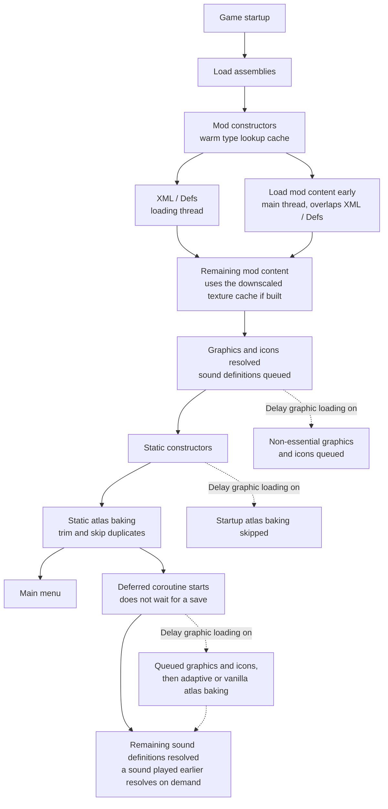

# Faster Game Loading - Continued (RimWorld 1.6)

[](http://rimworldgame.com/)
[](../LICENSE)


This page describes the **RimWorld 1.6** build. For RimWorld 1.7, see [the 1.7 README](../1.7/README.md); for installation and an overview, see [the main README](../README.md).

English | [繁體中文](README.zh-TW.md)

## Startup Flow



With the default settings, mod content, graphics, icons and static atlases are ready before the main menu; only sound definitions finish after it. The deferred coroutine is started by a startup callback, so it runs while the main menu is shown instead of waiting for a save to load. The downscaled texture cache is built manually with the **Downscale textures** tool and used by later startups.

## Features

Enabled by default:

- **Load mod content early**: Processes pending mod content during idle loading gaps before RimWorld's normal `ReloadContentInt` pass reaches those mods. It starts only after every mod constructor has run (at `LoadModXML`), so FGL's and other mods' Harmony patches already apply to early-loaded content. It stops once `PlayDataLoader.Loaded` is true and does not restart on language changes. The frame budget is checked between mods, so one large mod can still take a long frame. Texture byte preloading is skipped when Graphics Settings+ or Image Opt is active; bytes already read on the main thread are not prefetched again.
- **Multi-threaded preloading**: Loads XML assets in parallel while preserving RimWorld's original load-folder override order. With Hyperdrive, `Defs/` XML loading is left to Hyperdrive. A background thread also reads original texture files into memory in the order mods load them, holding at most 256 MB at a time, so the main thread does not wait on disk reads while loading textures. Files the main thread skips are released, and the rest is freed when startup finishes. This is skipped when Graphics Settings+ or Image Opt loads textures.
- **Type lookup cache**: Warms full type names before XML parsing and remembers resolved names across sessions. It follows RimWorld's assembly search order; full names that differ only in letter case are left to RimWorld's case-insensitive lookup so the same type is chosen. It refreshes when the mod list or any game/mod assembly changes, and falls back to RimWorld's lookup for stale entries. Harmony `AccessTools.TypeByName` keeps a separate per-session cache. Each assembly's types are listed once and shared with the `AccessTools.AllTypes` cache, which is rebuilt when an assembly is added or a dynamic assembly defines new types. Changes take effect after restarting the game.
- **Trim static atlases**: RimWorld packs each static atlas into a power-of-two height and doubles that height when the first attempt does not fit, so large atlases are often half empty rows. Each atlas keeps one empty row per mipmap level, with its height rounded up so every mip level is a multiple of 8 pixels for GPU compression. Every texture keeps its pixel position. Applies to RimWorld's baking and to **Adaptive atlas baking**. Changes take effect after restarting the game.
- **Skip duplicate atlas textures**: RimWorld queues a minifiable building's texture for the Building, Item and Misc atlases. Item and Misc copies are skipped when the texture is also queued for Building and its mask state is consistent across all queued groups. Copies with conflicting mask states are preserved so cross-group lookup cannot select the wrong mask. RimWorld's "found in another atlas group" warning is silenced for removed copies only. Changes take effect after restarting the game.

Always on (no setting):

- **Deferred sound resolution**: RimWorld's sound definition (`SubSoundDef`) resolution is queued and finished by the deferred coroutine after the main menu appears, even when **Delay graphic and icon loading** is off. A sound requested before its definition is resolved (for example a main-menu hover or click) is resolved on the spot and then played, so main-menu UI sounds work from the start; UI sounds take well under a millisecond each, while a sound with long clips (such as Anomaly ambience) can take up to about 200 ms; vanilla spends that same time before the main menu. Requests made off the main thread, or for sounds whose definitions are not queued yet (for example during a language-switch reload), are skipped, as before. With **Delay graphic and icon loading** on, the remaining sounds resolve after the deferred graphics, icons and atlas baking. Entering a world resolves any remaining sounds immediately.

Disabled by default:

- **Delay graphic and icon loading**: Moves some non-essential visual and icon work to batched processing after the startup callbacks; it begins while the main menu is shown, without waiting for a save to load. Essential categories such as furniture are chosen after Def references resolve. RimWorld's `ResolveIcon` handles icons before deferred atlas baking. Changes take effect after restarting the game.
- **Adaptive atlas baking**: Only takes effect together with **Delay graphic and icon loading**. The deferred static atlases are baked while the main menu is shown, several per frame until the frame's time budget (50 ms on the main menu, 8 ms in game) is used up. Each batch targets an amount of pixels sized from the measured GPU speed, at least 1024×1024 pixels' worth, so rendering still benefits from batching; the last batch of a group may be smaller, and a batch with a single texture uses that texture directly, so individual atlases can be smaller than 1024×1024. The budget is checked after each atlas, so it is not a hard cap: one large atlas can still take longer in a single frame. Textures queued by other mods while baking is in progress are baked too. Without delayed loading, RimWorld's original baking is used. Known risky race/multi-mask textures are kept out of static atlases. Changes take effect after restarting the game.
- **Faster atlas compression**: On the CPU path, compresses the baked static atlases with `Texture2D.Compress(highQuality: false)` instead of `true`. The high-quality mode adds dithering and takes longer. GPU compression is unchanged. Changes take effect after restarting the game.
- **Verbose logging**: Prints debugging messages. If it is already on when the game starts, after the first startup it also logs how long after the main menu appeared the deferred visuals and all deferred work became ready (work finished before the main menu counts as +0.0 s), for example `[FasterGameLoading] Startup timing after the main menu appeared: visuals ready +0.6 s, all deferred work done +3.0 s.` Loading time up to the main menu is not included; mods such as [Loading Progress](https://steamcommunity.com/sharedfiles/filedetails/?id=3535481557) show that. Nothing is logged when the game goes straight into a map without the main menu, and language switches do not log it again.

Manual tool:

- **Downscale textures**: Shows a loading screen while it downscales high-resolution textures into a separate cache (in successive halving steps to avoid aliasing). Original mod files are never modified, and cached textures use RimWorld's filtering and compression pipeline. Textures under `/UI/` keep mipmaps disabled. Original files are read and the cache PNGs are encoded and written on background threads; only decoding and GPU resizing run on the main thread. When the mod list changes, cache entries for still-active mods are retained. Rebuilding replaces the previous cache only after every new file is in place; if any cache file fails to write, or nothing could be written, the previous cache is kept. If you already use Graphics Settings+ or RimSort Optimize Texture, you usually do not need this. While Graphics Settings+ or Image Opt is loading textures, the tool is unavailable and the button is hidden.
- **Clear texture cache**: Shows a loading screen while it removes cached downscaled textures, so original textures are used on the next startup.

> [!NOTE]
> Brief startup unresponsiveness can be normal, especially with large mod lists. Sound definitions that are not resolved yet are resolved when a sound first plays, so the main menu is not silent.
> **Delay graphic and icon loading** is an advanced option. If you see texture or icon timing issues, disable it first.
> Downscaled texture cache can be cleared from the mod settings.
> Translations are provided for English, Simplified Chinese, Traditional Chinese and Russian. Other languages, and keys missing from a translation, fall back to English through RimWorld's own translation lookup, so with Dev Mode on they show RimWorld's pseudo-translated (accented) English, its marker for untranslated text.

## Where the Time Is Saved

Only the type lookup cache lowers the asymptotic cost. The other features do the same total work as vanilla, but split it across cores, run two kinds of work at the same time, shrink the input, or move work to after the main menu.

Symbols: `T` = types in all loaded assemblies, `U` = distinct type names resolved in a session, `K` = RimWorld's ignored namespace prefixes, `W` = total XML parsing work, `p` = min(CPU cores, 8), `P` = static atlas pixels.

| Feature | Vanilla | Faster Game Loading | Kind of saving |
| --- | --- | --- | --- |
| Type lookup cache | `O(U·(K+1)·T)`: each miss asks every assembly with a case-insensitive lookup, which Mono answers by scanning its type table, then retries with each namespace prefix; repeated every startup | `O(T + U)`: one hash table of full names built at startup, then a hash lookup per name; last session's short-name mappings skip the prefix retries | Asymptotic |
| Multi-threaded preloading | about `W / 2` elapsed: 2 threads per mod, mods one after another | about `W / p` elapsed, bounded below by the largest single file | Constant factor, up to about 4× |
| Load mod content early | `T_XML + T_content` | about `max(T_XML, T_content)` for the overlapping part | Overlap |
| Texture file preloading | `Σ(read + decode)` on the main thread | about `max(Σ read, Σ decode)`, with at most 256 MB read ahead | Overlap |
| Trim static atlases | `O(P)`, with heights padded to a power of two | `O(P′)`, up to about half the rows removed | Smaller input |
| Skip duplicate atlas textures | a minifiable building's texture baked up to 3 times | baked once in Building | Smaller input |
| Downscale textures (manual) | full-size decode and upload | each halving step leaves 1/4 of the pixels | Smaller input |
| Deferred sounds, delayed graphics and atlas baking | done before the main menu | same work, done after the main menu appears | Off the path to the main menu |

These bounds explain where the savings come from; they do not predict seconds, which depend on how large `T`, `U`, `W` and `P` are for a given mod list. RimWorld already caches resolved type names within a session and resolves the ignored-namespace short names through an exact-case dictionary, so only the lookups that miss those reach the slow path. Deferred work still has to finish; to measure total startup time, add the `Startup timing after the main menu appeared` line from **Verbose logging** to the time it takes to reach the main menu.

## Compatibility

Compatibility handling exists for:

- [Loading Progress](https://github.com/ilyvion/LoadingProgress)
- [Graphics Settings+](https://github.com/RealTelefonmast/GraphicsSetter)
- [HugsLib](https://github.com/UnlimitedHugs/RimworldHugsLib)
- [AyaTweaks](https://gitlab.com/WRelicK/AyaTweaks2.0) / Ayameduki mods
- [Humanoid Alien Races](https://github.com/erdelf/AlienRaces)
- [Ancot Library](https://steamcommunity.com/sharedfiles/filedetails/?id=2988801276)
- [ChezhouLib](https://steamcommunity.com/sharedfiles/filedetails/?id=3595247479)
- [Hyperdrive](https://github.com/vopaga/rimworld-hyperdrive)

Important behavior:

- With [Hyperdrive](https://github.com/vopaga/rimworld-hyperdrive), Faster Game Loading leaves parallel `Defs/` XML loading to Hyperdrive, which loads mods in parallel, and still parallelizes `Patches/` XML within each mod. Hyperdrive turns off its parallel mod loading when another mod has already patched `LoadModXML`. RimWorld does not construct mod classes in load order, so Faster Game Loading waits until Hyperdrive is constructed before it patches `LoadModXML`. This works in any load order. If Hyperdrive still turns off its parallel loading, Faster Game Loading keeps parsing `Defs/` in parallel itself.

- [Missile Girl - Performance Mod](https://github.com/ViralReaction/MissileGirl) and [DefLoadCache](https://github.com/FluxxField/rimworld-defload-cache) have no dedicated compatibility code in this mod. They are expected to work alongside Faster Game Loading, but use either Missile Girl or DefLoadCache, not both.
- [Image Opt](https://steamcommunity.com/sharedfiles/filedetails/?id=3543873568) compatibility is no longer maintained. When Faster Game Loading and Image Opt are enabled together, mods that depend on [Ancot Library](https://steamcommunity.com/sharedfiles/filedetails/?id=2988801276) may encounter graphical loading errors, missing textures, or black textures under some loading conditions. Using both mods together is not recommended; use [Image Opt fork](https://steamcommunity.com/sharedfiles/filedetails/?id=3781013698) instead.
- Existing Image Opt safeguards, such as downscaled-texture bypass and invalid `.dds` / `.dds.zstd` cache cleanup, do not guarantee compatibility.
- [Image Opt fork](https://steamcommunity.com/sharedfiles/filedetails/?id=3781013698) is an alternative to Image Opt, patched by its author for compatibility with Faster Game Loading. Load it after Faster Game Loading.
- [Humanoid Alien Races](https://github.com/erdelf/AlienRaces) counts each race's texture variants as soon as its own textures are loaded. Faster Game Loading holds that count until all mod content has loaded, so variants from race mods that load later are not missed. With this in place, HAR and the race mods that depend on it are loaded early and have their XML parsed in parallel like other mods. If the hook cannot be found or patched, they are excluded from both again.
- HAR (including its dev build) and Ancot-related race mods are not downscaled and stay out of **Adaptive atlas baking**, to reduce bodyAddon, hair, ear, and multi-mask texture issues. The same applies to [Pumpkin Library](https://steamcommunity.com/sharedfiles/filedetails/?id=3790461769) DDS texture packs that replace those mods' textures, as listed in Pumpkin Library's `TextureOverrideSettings.xml`. AyaTweaks and Ayameduki mods skip early loading and parallel XML parsing.
- With [ChezhouLib](https://steamcommunity.com/sharedfiles/filedetails/?id=3595247479), Faster Game Loading's guard against loading the same asset bundles twice runs before ChezhouLib's asset bundle loader.

## Recommended Settings

Most players should start with the defaults.

If loading is still slow:

1. Keep **Load mod content early**, **Multi-threaded preloading**, and **Type lookup cache** enabled.
2. For large texture-heavy mod lists, prefer Graphics Settings+ or RimSort Optimize Texture. Image Opt compatibility is no longer maintained; use [Image Opt fork](https://steamcommunity.com/sharedfiles/filedetails/?id=3781013698) instead.
3. If you do not use an external texture tool, consider FGL's **Downscale textures** tool.
4. Enable **Delay graphic and icon loading** or **Adaptive atlas baking** only if you are willing to troubleshoot compatibility issues.

## Building from Source

The 1.6 source lives in `1.6/Source/` and the build writes its DLL to `1.6/Assemblies/`. Features are grouped into folders such as `Core/`, `Settings/`, `XMLLoadingCache/`, `EarlyModContentLoading/`, `TextureDownscaler/`, `AdaptiveAtlasBaking/`, `StaticAtlasOptimizations/`, `DelayGraphicAndIconLoading/`, `DelaySoundLoading/`, `Compatibility/`, `Language/` and `Utilities/`, with NUnit tests in `FasterGameLoading.Tests/`.

The 1.6 build targets .NET Framework 4.7.2 and references RimWorld via the [Krafs.Rimworld.Ref](https://www.nuget.org/packages/Krafs.Rimworld.Ref) NuGet package, so no local RimWorld 1.6 installation is needed to compile. Run these from the repository root:

```bash
dotnet build 1.6/Source/FasterGameLoading.csproj -c Release
```

Tests use NUnit on .NET 9, run through Microsoft.Testing.Platform:

```bash
dotnet test 1.6/Source/FasterGameLoading.Tests/FasterGameLoading.Tests.csproj
```

`global.json` opts into the Microsoft.Testing.Platform `dotnet test` experience, so run the command from the repository root or from `1.6/Source/`. The platform needs it: it runs the test assembly's entry point before discovery, which is what lets `TestSetup` register the assembly resolver that loads the game's `Assembly-CSharp.dll` and `UnityStubs.dll` at run time. The VSTest path reflects over the test assembly before any of that code runs, finds no tests, and reports "NUnit couldn't find any tests". The 1.6 suite needs the real RimWorld 1.6 managed assemblies at run time: `Krafs.Rimworld.Ref` is a compile-time reference package whose assemblies carry no method bodies, so they cannot stand in for the game. `TestSetup` loads them from `RimWorldWin64_Data\Managed` next to the installed game, and `RIMWORLD_MANAGED_DIR` overrides that location. RimWorld 1.6 and 1.7 share one Steam installation directory, so only one of them can be present at a time; the 1.6 suite therefore needs the game on 1.6, while the 1.7 suite needs it on 1.7. The resolver also compares the `Assembly-CSharp.dll` version against the one the suite was compiled for and refuses to load a different RimWorld version, so a suite can never pass against the other version.
