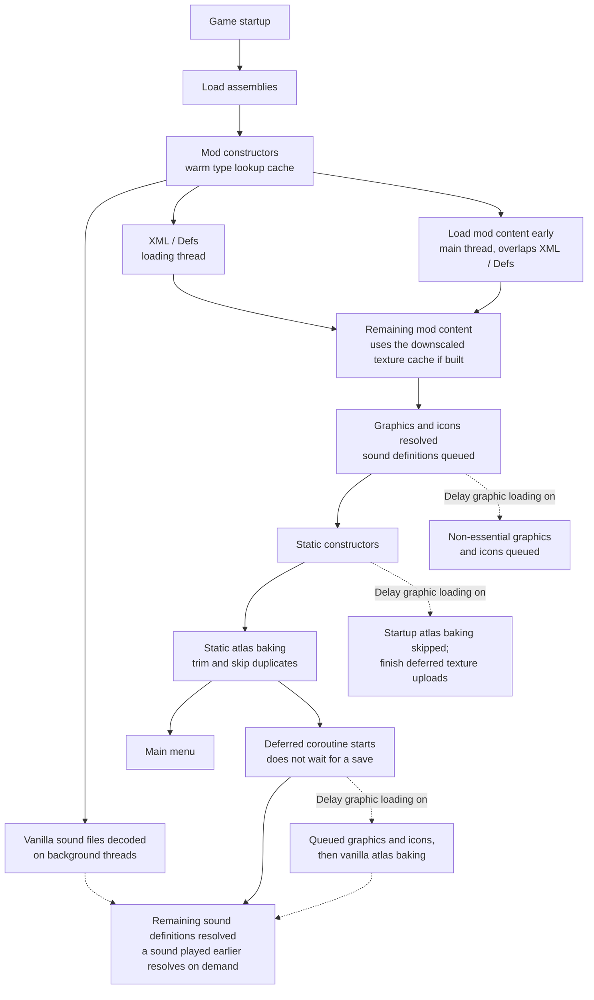

# Faster Game Loading - Continued (RimWorld 1.7)

[](http://rimworldgame.com/)
[](../LICENSE)


This page describes the **RimWorld 1.7** build. For RimWorld 1.6, see [the 1.6 README](../1.6/README.md); for installation and an overview, see [the main README](../README.md).

English | [繁體中文](README.zh-TW.md)

RimWorld 1.7 runs on a new engine (Waylith on .NET 10) instead of Unity and Mono. It already prefetches mod textures and caches compressed atlases on disk, so the 1.7 build differs from the 1.6 build:

- **Vanilla sound prewarm** (new, part of **Multi-threaded preloading**): see [Features](#features).
- **Texture read-ahead** is not used; RimWorld 1.7 reads textures with its own prefetcher.
- **Faster atlas compression** is not available; RimWorld 1.7 has no matching compression step and its `Compress` has no quality switch, so the option is hidden. Its saved value is kept for when you switch back to 1.6.
- **Adaptive atlas baking** is not available (RimWorld 1.6 only); it would bypass the end-of-load step, atlas compression, the on-disk atlas cache and source-texture eviction of RimWorld 1.7's own baking, so the option is hidden and RimWorld's baking always runs, including under **Delay graphic and icon loading**. Its saved value is kept for when you switch back to 1.6.

## Startup Flow



With the default settings, mod content, graphics, icons and static atlases are ready before the main menu; only sound definitions finish after it, and because the vanilla sound files were already decoded in the background, they finish almost immediately. The deferred coroutine is started by a startup callback, so it runs while the main menu is shown instead of waiting for a save to load. The downscaled texture cache is built manually with the **Downscale textures** tool and used by later startups.

## Features

Enabled by default:

- **Load mod content early**: Processes pending mod content during idle loading gaps before RimWorld's normal `ReloadContentInt` pass reaches those mods. It starts only after every mod constructor has run (at `LoadModXML`), so FGL's and other mods' Harmony patches already apply to early-loaded content. It stops once `PlayDataLoader.Loaded` is true and does not restart on language changes. The frame budget is checked between mods, so one large mod can still take a long frame.
- **Multi-threaded preloading**: Loads XML assets in parallel while preserving RimWorld's original load-folder override order. With Hyperdrive, `Defs/` XML loading is left to Hyperdrive. It also prewarms the vanilla sounds: RimWorld 1.7 decodes every vanilla sound file one by one on the main thread the first time its sound definition is resolved, about 4 seconds in total, and its own prefetcher does not cover these files. When the mod starts, a background task decodes all vanilla sound files into the engine's resource cache while the main thread is still parsing XML, so resolving sound definitions later only finds them in the cache. The decoding uses half the CPU cores minus one, between 1 and 4 threads (for example 1 thread on 4 cores, 3 on 8 cores, 4 on 10 or more). It uses an internal engine method; if a game update removes it, the prewarm is skipped and RimWorld loads the sounds as before. It decodes all vanilla sound files, including ones no sound definition uses. The texture read-ahead of the 1.6 build is not used, because RimWorld 1.7 opens texture files itself with its own prefetcher, so bytes read ahead would never be taken.
- **Type lookup cache**: Warms full type names before XML parsing and remembers resolved names across sessions. It follows RimWorld's assembly search order; full names that differ only in letter case are left to RimWorld's case-insensitive lookup so the same type is chosen. It refreshes when the mod list or any game/mod assembly changes, and falls back to RimWorld's lookup for stale entries. Harmony `AccessTools.TypeByName` keeps a separate per-session cache. Each assembly's types are listed once and shared with the `AccessTools.AllTypes` cache, which is rebuilt when an assembly is added or a dynamic assembly defines new types. Changes take effect after restarting the game.
- **Trim static atlases**: RimWorld packs each static atlas into a power-of-two height and doubles that height when the first attempt does not fit, so large atlases are often half empty rows. Each atlas keeps one empty row per mipmap level, with its height rounded up so every mip level is a multiple of 8 pixels for block compression. Every texture keeps its pixel position, and the trimmed atlas keeps the original page's sampling settings (filtering, wrap mode, anisotropy, mip bias). Applies to RimWorld's baking. Memory use drops, and cold bakes (no on-disk atlas cache yet) get faster. Changes take effect after restarting the game.
- **Skip duplicate atlas textures**: RimWorld queues a minifiable building's texture for the Building, Item and Misc atlases. Item and Misc copies are skipped when the texture is also queued for Building and its mask state is consistent across all queued groups. Copies with conflicting mask states are preserved so cross-group lookup cannot select the wrong mask. RimWorld's "found in another atlas group" warning is silenced for removed copies only. Changes take effect after restarting the game.

Always on (no setting):

- **Deferred sound resolution**: RimWorld's sound definition (`SubSoundDef`) resolution is queued and finished by the deferred coroutine after the main menu appears, even when **Delay graphic and icon loading** is off. A sound requested before its definition is resolved (for example a main-menu hover or click) is resolved on the spot and then played, so main-menu UI sounds work from the start. Requests made off the main thread, or for sounds whose definitions are not queued yet (for example during a language-switch reload), are skipped, as before. With **Delay graphic and icon loading** on, the remaining sounds resolve after the deferred graphics, icons and atlas baking. Entering a world resolves any remaining sounds immediately.

Disabled by default:

- **Delay graphic and icon loading**: Moves some non-essential visual and icon work to batched processing after the startup callbacks; it begins while the main menu is shown, without waiting for a save to load. When startup atlas baking is skipped, RimWorld 1.7's deferred texture uploads are still finished before the main menu; textures already queued as atlas sources stay evicted until needed. Queued graphics and icons then finish, followed by RimWorld's own atlas baking, compression, disk caching and source-texture eviction. Essential categories such as furniture are chosen after Def references resolve. RimWorld's `ResolveIcon` handles icons before deferred atlas baking. This option stays disabled by default: the main menu can appear sooner, but the deferred work can cause a long frame afterward and increase memory use. Changes take effect after restarting the game.
- **Verbose logging**: Prints debugging messages. If it is already on when the game starts, after the first startup it also logs how long after the main menu appeared the deferred visuals and all deferred work became ready (work finished before the main menu counts as +0.0 s), for example `[FasterGameLoading] Startup timing after the main menu appeared: visuals ready +0.6 s, all deferred work done +3.0 s.` It also logs how many vanilla sound files the prewarm decoded, how long it took and how many failed. Loading time up to the main menu is not included. Nothing is logged when the game goes straight into a map without the main menu, and language switches do not log it again.

Manual tool:

- **Downscale textures**: Shows a loading screen while it downscales high-resolution textures into a separate cache (in successive halving steps to avoid aliasing). Original mod files are never modified, and cached textures use RimWorld's filtering, mipmap and compression pipeline. Textures under `/UI/` keep mipmaps disabled. Original files are read and the cache PNGs are encoded and written on background threads; only decoding and GPU resizing run on the main thread. Background PNG encoding preserves the same pixel row direction as RimWorld's texture encoder. When the mod list changes, cache entries for still-active mods are retained. Rebuilding replaces the previous cache only after every new file is in place; if any cache file fails to write, or nothing could be written, the previous cache is kept. If you already use Graphics Settings+ or RimSort Optimize Texture, you usually do not need this. While Graphics Settings+ or Image Opt is loading textures, the tool is unavailable and the button is hidden.
- **Clear texture cache**: Shows a loading screen while it removes cached downscaled textures, so original textures are used on the next startup.

> [!NOTE]
> Brief startup unresponsiveness can be normal, especially with large mod lists. Sound definitions that are not resolved yet are resolved when a sound first plays, so the main menu is not silent.
> **Delay graphic and icon loading** is an advanced option. If you see texture or icon timing issues, disable it first.
> Downscaled texture cache can be cleared from the mod settings.
> Translations are provided for English, Simplified Chinese, Traditional Chinese and Russian. Other languages, and keys missing from a translation, fall back to English through RimWorld's own translation lookup, so with Dev Mode on they show RimWorld's pseudo-translated (accented) English, its marker for untranslated text.

## Measured Startup Time

Measured on RimWorld 1.7 with only the Core game active (3 runs each, seconds from process start; "after the main menu" is the deferred work logged by **Verbose logging**):

| Setup | To the main menu | After the main menu | Total |
| --- | --- | --- | --- |
| Vanilla | 16.8 | — | 16.8 |
| Default settings, without the sound prewarm | 13.3 | +3.8 | 17.1 |
| Default settings, with the sound prewarm | 14.1 | +0.0 | 14.1 |

Without the prewarm, deferring sound resolution only moved the decoding to after the main menu. With it, sounds are ready when the main menu appears and total startup is about 3 seconds shorter. Reaching the main menu takes slightly longer because the prewarm shares the CPU with startup. This Core-only comparison does not establish the full-startup gain for larger mod lists.

Earlier exploratory runs of delayed graphics with the 1.7 texture-upload fix reached the main menu in 16.60–16.77 seconds from the FGL constructor, compared with 18.78–19.44 seconds with delayed graphics off. They also recorded a 1.10–1.20-second frame after the menu and about 130 MB more managed memory. These use a different timer from the Core-only table and do not establish a reduction in total startup time; the post-menu work must also be counted.

On 2026-10-16, moving full-type-name warmup to the background was compared with synchronous warmup on RimWorld 1.7.4980 rev60, with Core, Harmony, VEF, VTEXE, Loading Progress, FGL and the test bridge. After warmup, three interleaved runs per variant gave main-menu medians of 8.793 seconds (synchronous) and 8.817 seconds (background), measured by Loading Progress from its first loading-window draw. FGL's post-menu work was +0.0 seconds in every run. The background runs ranged from 8.335 to 9.465 seconds, so this small mod list did not demonstrate a benefit from background type warmup. These timings use another starting point and cannot be directly compared with the earlier tables.

Synchronous type warmup is retained so the cache is ready before XML parsing, without an additional background task or concurrent merge and cleanup behavior.

## Where the Time Is Saved

The type lookup cache removes repeated work per type name. The other features do the same total work as vanilla, but split it across cores, run two kinds of work at the same time, shrink the input, or move work to after the main menu.

Symbols: `T` = types in all loaded assemblies, `A` = active assemblies, `U` = distinct type names resolved in a session, `K` = RimWorld's ignored namespace prefixes, `W` = total XML parsing work, `p` = min(CPU cores, 8), `P` = static atlas pixels, `S` = vanilla sound decoding work, `t` = sound prewarm threads = CPU cores / 2 − 1, clamped to 1–4.

| Feature | Vanilla | Faster Game Loading | Kind of saving |
| --- | --- | --- | --- |
| Type lookup cache | `O(T + U·(K+1)·A)` (assumed): stock .NET answers a case-insensitive lookup from a per-assembly hash table it builds on first use, but each miss still asks every assembly, then retries with each namespace prefix; repeated every startup. This is stock .NET behavior and has not been verified on Waylith's .NET fork; if it still scans the type table, the vanilla cost is `O(U·(K+1)·T)` as on 1.6 | `O(T + U)`: one hash table of full names built at startup, then a hash lookup per name; last session's short-name mappings skip the prefix retries | Fewer lookups per name (asymptotic if Waylith scans) |
| Multi-threaded preloading (XML) | about `W / 3` elapsed: the calling thread plus 2 threads per mod, mods one after another | about `W / p` elapsed, bounded below by the largest single file | Constant factor, small in practice: about 10%–23% faster (about 0.1–0.25 s) with 37 mods, 3,980 XML files and 6 cores |
| Multi-threaded preloading (vanilla sounds) | `S` on the main thread, one file at a time | about `S / t` on background threads, overlapping XML parsing | Off the main thread, constant factor |
| Load mod content early | `T_XML + T_content` | about `max(T_XML, T_content)` for the overlapping part | Overlap |
| Trim static atlases | `O(P)`, with heights padded to a power of two | `O(P′)`, up to about half the rows removed | Smaller input |
| Skip duplicate atlas textures | a minifiable building's texture baked up to 3 times | baked once in Building | Smaller input |
| Downscale textures (manual) | full-size decode and upload | each halving step leaves 1/4 of the pixels | Smaller input |
| Deferred sounds, delayed graphics and atlas baking | done before the main menu | same work, done after the main menu appears | Off the path to the main menu |

These bounds explain where the savings come from; they do not predict seconds, which depend on how large `T`, `U`, `W`, `P` and `S` are for a given mod list. RimWorld already caches resolved type names within a session and resolves the ignored-namespace short names through an exact-case dictionary, so only the lookups that miss those reach the slow path. Deferred work still has to finish; to measure total startup time, add the `Startup timing after the main menu appeared` line from **Verbose logging** to the time it takes to reach the main menu.

## Compatibility

Compatibility handling exists for:

- [Loading Progress](https://github.com/ilyvion/LoadingProgress)
- [Graphics Settings+](https://github.com/RealTelefonmast/GraphicsSetter)
- [HugsLib](https://github.com/UnlimitedHugs/RimworldHugsLib)
- [AyaTweaks](https://gitlab.com/WRelicK/AyaTweaks2.0) / Ayameduki mods
- [Humanoid Alien Races](https://github.com/erdelf/AlienRaces)
- [Ancot Library](https://steamcommunity.com/sharedfiles/filedetails/?id=2988801276)
- [ChezhouLib](https://steamcommunity.com/sharedfiles/filedetails/?id=3595247479)
- [Hyperdrive](https://github.com/vopaga/rimworld-hyperdrive)

Most of this handling is shared with the 1.6 build; the HAR graphics hook also waits for Def loading to finish on 1.7. Availability and behavior on 1.7 have not been checked for every mod listed here.

Important behavior:

- With [Hyperdrive](https://github.com/vopaga/rimworld-hyperdrive), Faster Game Loading leaves parallel `Defs/` XML loading to Hyperdrive, which loads mods in parallel, and still parallelizes `Patches/` XML within each mod. Hyperdrive turns off its parallel mod loading when another mod has already patched `LoadModXML`. RimWorld does not construct mod classes in load order, so Faster Game Loading waits until Hyperdrive is constructed before it patches `LoadModXML`. This works in any load order. If Hyperdrive still turns off its parallel loading, Faster Game Loading keeps parsing `Defs/` in parallel itself.

- [Missile Girl - Performance Mod](https://github.com/ViralReaction/MissileGirl) and [DefLoadCache](https://github.com/FluxxField/rimworld-defload-cache) have no dedicated compatibility code in this mod. They are expected to work alongside Faster Game Loading, but use either Missile Girl or DefLoadCache, not both.
- [Image Opt](https://steamcommunity.com/sharedfiles/filedetails/?id=3543873568) compatibility is no longer maintained. When Faster Game Loading and Image Opt are enabled together, mods that depend on [Ancot Library](https://steamcommunity.com/sharedfiles/filedetails/?id=2988801276) may encounter graphical loading errors, missing textures, or black textures under some loading conditions. Using both mods together is not recommended; use [Image Opt fork](https://steamcommunity.com/sharedfiles/filedetails/?id=3781013698) instead.
- Existing Image Opt safeguards, such as downscaled-texture bypass and invalid `.dds` / `.dds.zstd` cache cleanup, do not guarantee compatibility.
- [Image Opt fork](https://steamcommunity.com/sharedfiles/filedetails/?id=3781013698) is an alternative to Image Opt, patched by its author for compatibility with Faster Game Loading. Load it after Faster Game Loading.
- [Humanoid Alien Races](https://github.com/erdelf/AlienRaces) scans queued races' texture variants once its own textures are loaded. Faster Game Loading holds that scan until Def reference resolution and all mod content loading have finished. This prevents the scan from enumerating HAR's pending-race set while background reference resolution is still adding races, which can cause `Collection was modified`, and keeps variants from later-loaded race mods from being missed. HAR and its dependent race mods can still load content early and parse XML in parallel. If the hook cannot be found or patched, they are excluded from both again.
- HAR (including its dev build) and Ancot-related race mods are not downscaled, to reduce bodyAddon, hair, ear, and multi-mask texture issues. The same applies to [Pumpkin Library](https://steamcommunity.com/sharedfiles/filedetails/?id=3790461769) DDS texture packs that replace those mods' textures, as listed in Pumpkin Library's `TextureOverrideSettings.xml`. AyaTweaks and Ayameduki mods skip early loading and parallel XML parsing.
- With [ChezhouLib](https://steamcommunity.com/sharedfiles/filedetails/?id=3595247479), Faster Game Loading's guard against loading the same asset bundles twice runs before ChezhouLib's asset bundle loader.

## Recommended Settings

Most players should start with the defaults.

If loading is still slow:

1. Keep **Load mod content early**, **Multi-threaded preloading**, and **Type lookup cache** enabled.
2. For large texture-heavy mod lists, prefer Graphics Settings+ or RimSort Optimize Texture. Image Opt compatibility is no longer maintained; use [Image Opt fork](https://steamcommunity.com/sharedfiles/filedetails/?id=3781013698) instead.
3. If you do not use an external texture tool, consider FGL's **Downscale textures** tool.
4. Enable **Delay graphic and icon loading** only if you are willing to troubleshoot compatibility issues.

## Building from Source

The 1.7 source lives in `1.7/Source/` and the build writes its DLL to `1.7/Assemblies/`. It started as a copy of the 1.6 source and is maintained separately; feature folders are the same as in 1.6 (`Core/`, `Settings/`, `XMLLoadingCache/`, `EarlyModContentLoading/`, `TextureDownscaler/`, `AdaptiveAtlasBaking/`, `StaticAtlasOptimizations/`, `DelayGraphicAndIconLoading/`, `DelaySoundLoading/`, `Compatibility/`, `Language/` and `Utilities/`), with NUnit tests in `FasterGameLoading.Tests/`.

The 1.7 build targets .NET 10 and is written with current C# language features and .NET 10 APIs, so it does not compile for 1.6. RimWorld 1.7 now ships the `Krafs.Rimworld.Ref` NuGet reference package (1.7.4982-unstable), so the build no longer needs a local RimWorld installation for the game assemblies (`Assembly-CSharp.dll`, `UnityStubs.dll`, `Waylith.dll` and friends); only the 1.7 `0Harmony.dll` from the Harmony Workshop item is still referenced directly. Run these from the repository root:

```bash
dotnet build 1.7/Source/FasterGameLoading.csproj -c Release
```

Tests use NUnit on .NET 10, run through Microsoft.Testing.Platform:

```bash
dotnet test --project 1.7/Source/FasterGameLoading.Tests/FasterGameLoading.Tests.csproj
```

`global.json` opts into the Microsoft.Testing.Platform `dotnet test` experience. Run the command from the repository root; the `--project` option is required by the .NET 10 SDK. The platform runs the test assembly's entry point before discovery, which lets `TestSetup` register the assembly resolver that loads the game's `Assembly-CSharp.dll` and `UnityStubs.dll` at run time. The VSTest path reflects over the test assembly before any of that code runs, finds no tests, and reports "NUnit couldn't find any tests". The `Krafs.Rimworld.Ref` package only carries reference assemblies, so those game assemblies are not in the test output folder and have to be resolved from the local RimWorld installation at run time. RimWorld 1.6 and 1.7 share one Steam installation directory, so only one of them can be present at a time; the 1.7 suite therefore needs the game on 1.7. The resolver refuses to load an `Assembly-CSharp.dll` whose version belongs to the other RimWorld release, so a suite never runs silently against the wrong game.

In-game integration tests and type-lookup benchmarks use a pinned DevTools build in a separate development-only mod. See the [in-game test guide](Source/FasterGameLoading.InGameTests/README.md) for setup, Test Explorer, Smoke Test, and test scenarios. The player-facing `1.7/Assemblies/` does not require DevTools. The NUnit suite continues to use the `dotnet test` command above. RimWorld 1.6 does not integrate DevTools.
