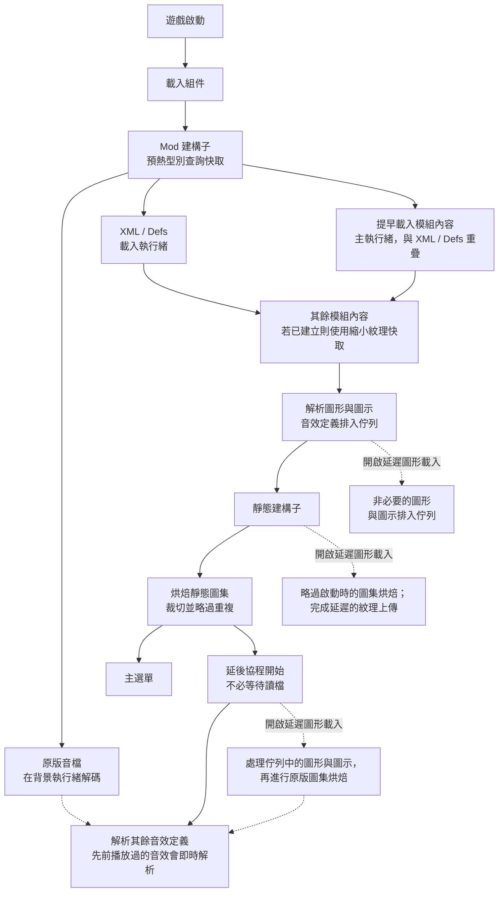

# Faster Game Loading - Continued（RimWorld 1.7）

[](http://rimworldgame.com/)
[](../LICENSE)


本頁說明 **RimWorld 1.7** 版。RimWorld 1.6 請見 [1.6 README](../1.6/README.zh-TW.md)；安裝方式與總覽請見[主 README](../README.zh-TW.md)。

[English](README.md) | 繁體中文

RimWorld 1.7 改用新引擎（Waylith，執行於 .NET 10），不再使用 Unity 與 Mono。它本身已會預取模組紋理，並把壓縮後的圖集快取到磁碟，所以 1.7 版與 1.6 版有以下差異：

- **原版音效預熱**（新增，屬於 **多執行緒預載入**）：見[功能](#功能)。
- **紋理預讀** 不使用；RimWorld 1.7 用自己的預取器讀取紋理。
- **較快的圖集壓縮** 無法使用；RimWorld 1.7 沒有對應的壓縮步驟，它的 `Compress` 也沒有品質開關，所以這個選項會隱藏。已儲存的設定值會保留，切回 1.6 時仍然有效。
- **自適應圖集烘焙** 無法使用（僅限 RimWorld 1.6）；它會繞過 RimWorld 1.7 自身烘焙的載入收尾步驟、圖集壓縮、磁碟圖集快取與來源紋理釋放，所以這個選項會隱藏，包含開啟 **延遲圖形和圖示載入** 時，一律使用 RimWorld 的烘焙。已儲存的設定值會保留，切回 1.6 時仍然有效。

## 啟動流程



使用預設設定時，模組內容、圖形、圖示與靜態圖集都會在主選單出現前準備好，只有音效定義在主選單出現後才完成；由於原版音檔已在背景解碼，它們幾乎立即完成。延後協程由啟動回呼啟動，因此會在顯示主選單時執行，不必等到讀取存檔。縮小紋理快取需用 **縮小紋理** 工具手動建立，之後的啟動才會使用。

## 功能

預設開啟：

- **提早載入模組內容**：在 RimWorld 正常的 `ReloadContentInt` 輪到各模組之前，利用載入過程中的空檔處理待載入的模組內容。它要等所有 Mod 建構子都執行完（在 `LoadModXML` 時）才開始，因此 FGL 與其他模組的 Harmony 補丁都已套用到提早載入的內容。`PlayDataLoader.Loaded` 為 true 後就停止，切換語言時也不會重新啟動。每幀的時間預算是在模組之間檢查，所以單一大型模組仍可能佔用較長的一幀。
- **多執行緒預載入**：平行載入 XML 資源，同時保留 RimWorld 原本的載入資料夾覆寫順序。搭配 Hyperdrive 時，`Defs/` 的 XML 載入交給 Hyperdrive。它也會預熱原版音效：RimWorld 1.7 在第一次解析音效定義時，會在主執行緒上逐一解碼每個原版音檔，總共約 4 秒，而它自己的預取器不涵蓋這些檔案。模組啟動時，一個背景工作會在主執行緒還在解析 XML 時，把所有原版音檔解碼進引擎的資源快取，之後解析音效定義只需從快取取得。背景解碼使用的執行緒數為 CPU 核心數的一半減一，介於 1 到 4 條之間（例如 4 核心為 1 條、8 核心為 3 條、10 核心以上為 4 條）。它使用引擎的內部方法；若遊戲更新移除了該方法，預熱會略過，RimWorld 照舊自行載入音效。它會解碼所有原版音檔，包括沒有任何音效定義使用的檔案。1.6 版的紋理預讀不使用，因為 RimWorld 1.7 自己開啟紋理檔並使用自己的預取器，預讀的位元組永遠不會被取用。
- **型別查詢快取**：在解析 XML 前預熱完整型別名稱，並跨遊戲階段記住已解析的名稱。它遵循 RimWorld 的組件搜尋順序；只有大小寫不同的完整名稱交給 RimWorld 自己不分大小寫的查詢，確保選到同一個型別。模組清單或任何遊戲／模組組件變更時會重新整理，過期的項目則退回 RimWorld 原本的查詢。Harmony 的 `AccessTools.TypeByName` 另有每個遊戲階段的快取。每個組件的型別只列舉一次，並與 `AccessTools.AllTypes` 快取共用；新增組件或動態組件定義了新型別時，該快取會重建。變更後需重新啟動遊戲才生效。
- **裁切靜態圖集**：RimWorld 會把每張靜態圖集的高度補到 2 的次方，第一次放不下時再加倍，所以大型圖集常有一半是空白列。每張圖集為每一層 mipmap 保留一列空白，高度向上取整，讓每一層 mipmap 都是 8 像素的倍數以利區塊壓縮。每張紋理的像素位置不變，裁切後的圖集也沿用原頁面的取樣設定（過濾、環繞模式、各向異性、mip 偏移）。適用於 RimWorld 原本的烘焙。記憶體用量會降低，冷烘焙（尚無磁碟圖集快取）也會更快。變更後需重新啟動遊戲才生效。
- **略過重複的圖集紋理**：RimWorld 會把可搬運建築的紋理同時排入 Building、Item 與 Misc 三組圖集。當紋理也排入了 Building，且它在所有排入群組中的遮罩狀態一致時，略過 Item 與 Misc 的副本。遮罩狀態互相衝突的副本會保留，避免跨群組查詢時選到錯誤的遮罩。RimWorld 的「found in another atlas group」警告只對被移除的副本靜音。變更後需重新啟動遊戲才生效。

一律開啟（沒有設定項）：

- **延後解析音效**：RimWorld 的音效定義（`SubSoundDef`）解析會排入佇列，在主選單出現後由延後協程完成，即使 **延遲圖形和圖示載入** 關閉也一樣。音效定義尚未解析前就被要求播放的音效（例如主選單的滑過或點擊）會當場解析再播放，所以主選單的介面音效一開始就能使用。在主執行緒以外發出的請求，或音效定義尚未排入佇列（例如切換語言重新載入期間）的請求，會照舊略過。開啟 **延遲圖形和圖示載入** 時，其餘音效會在延後的圖形、圖示與圖集烘焙之後解析。進入世界時，剩下的音效會立即解析。

預設關閉：

- **延遲圖形和圖示載入**：把部分非必要的圖形與圖示工作移到啟動回呼之後分批處理；它在顯示主選單時就開始，不必等待讀取存檔。略過啟動圖集烘焙時，仍會在主選單前完成 RimWorld 1.7 延遲的紋理上傳；已排入圖集的來源紋理維持未駐留，等需要時才載入。佇列中的圖形與圖示完成後，再執行 RimWorld 原本的圖集烘焙、壓縮、磁碟快取與來源紋理釋放。家具等必要類別會在 Def 參照解析後才決定。RimWorld 的 `ResolveIcon` 會在延後的圖集烘焙之前處理圖示。此選項繼續預設關閉：主選單可以提早出現，但延後工作可能造成選單後的長幀與記憶體用量增加。變更後需重新啟動遊戲才生效。
- **啟用詳細日誌**：輸出除錯訊息。若遊戲啟動時就已開啟，第一次啟動後還會記錄主選單出現後，延後的視覺內容與全部延後工作各自多久後完成（主選單前就完成的工作記為 +0.0 s），例如 `[FasterGameLoading] Startup timing after the main menu appeared: visuals ready +0.6 s, all deferred work done +3.0 s.` 也會記錄音效預熱解碼了多少個原版音檔、花了多久，以及失敗幾個。不包含到主選單為止的載入時間。遊戲不經主選單直接進入地圖時不會記錄，切換語言也不會再記錄一次。

手動工具：

- **縮小紋理**：顯示載入畫面，把高解析度紋理縮小後存進獨立的快取（分多次減半以避免鋸齒）。原始模組檔案永遠不會被修改，快取的紋理沿用 RimWorld 的過濾、mipmap 與壓縮流程。`/UI/` 下的紋理保持不產生 mipmap。原始檔的讀取，以及快取 PNG 的編碼與寫入都在背景執行緒進行；只有解碼與 GPU 縮放在主執行緒執行。背景編碼的 PNG 會維持與 RimWorld 貼圖編碼相同的像素列方向。模組清單變更時，仍在使用中的模組的快取項目會保留。重建時要等每個新檔案都就位才取代舊快取；任何快取檔寫入失敗，或完全沒有寫入任何檔案時，保留舊快取。如果已經在用 Graphics Settings+ 或 RimSort Optimize Texture，通常不需要這項工具。由 Graphics Settings+ 或 Image Opt 載入紋理時無法使用此工具，按鈕也會隱藏。
- **清除紋理快取**：顯示載入畫面並移除已快取的縮小紋理，下次啟動改用原始紋理。

> [!NOTE]
> 啟動時短暫沒有回應可能是正常的，模組清單越大越明顯。尚未解析的音效定義會在第一次播放時解析，所以主選單不會沒有聲音。
> **延遲圖形和圖示載入** 是進階選項。如果遇到紋理或圖示的時序問題，請先關閉它。
> 縮小紋理快取可以在模組設定中清除。
> 翻譯提供英文、簡體中文、繁體中文與俄文。其他語言以及翻譯中缺少的鍵，會透過 RimWorld 自己的翻譯查詢退回英文，因此開啟開發者模式時會顯示 RimWorld 的偽翻譯（帶重音符號的）英文，也就是它標示未翻譯文字的方式。

## 實測啟動時間

在 RimWorld 1.7 上只啟用 Core 量測（各 3 次，自程序啟動起算的秒數；「主選單後」是 **啟用詳細日誌** 記錄的延後工作）：

| 設定 | 到主選單 | 主選單後 | 合計 |
| --- | --- | --- | --- |
| 原版 | 16.8 | — | 16.8 |
| 預設設定，不含音效預熱 | 13.3 | +3.8 | 17.1 |
| 預設設定，含音效預熱 | 14.1 | +0.0 | 14.1 |

沒有預熱時，延後解析音效只是把解碼移到主選單之後。有了預熱，主選單出現時音效已準備好，總啟動時間約縮短 3 秒。到達主選單的時間稍微變長，因為預熱與啟動共用 CPU。這組僅啟用 Core 的比較，無法判定較大模組清單的完整啟動收益。

先前的探索量測中，延遲圖形搭配 1.7 紋理上傳修正，從 FGL 建構子到主選單為 16.60–16.77 秒；關閉延遲圖形則為 18.78–19.44 秒。同時也記錄到選單後 1.10–1.20 秒的單幀，以及約 130 MB 的額外受控記憶體。這些數據與上方 Core 表格使用不同計時起點，尚不能證明總啟動時間減少，仍須計入主選單後的工作。

2026-10-16 在 RimWorld 1.7.4980 rev60，以 Core、Harmony、VEF、VTEXE、Loading Progress、FGL 與測試橋接模組，比較完整型別名稱的同步與背景預熱。暖機後各交錯執行三次，Loading Progress 從載入視窗第一次繪製到主選單的中位數為同步 8.793 秒、背景 8.817 秒；每次 FGL 的選單後工作皆為 +0.0 秒。背景組範圍為 8.335–9.465 秒，因此這份小型模組清單未證實背景型別預熱有收益。這組計時起點也不同，不能直接與前面的表格比較。

因此保留同步型別預熱，讓 XML 解析前快取就已準備好，也省去額外背景工作及並行合併、清理的複雜度。

## 時間省在哪裡

型別查詢快取省去每個型別名稱的重複工作。其他功能做的總工作量和原版相同，只是分散到多個核心、讓兩種工作同時進行、縮小輸入，或把工作移到主選單之後。

符號：`T` = 所有已載入組件中的型別數，`A` = 啟用中的組件數，`U` = 一個遊戲階段中解析的不同型別名稱數，`K` = RimWorld 忽略的命名空間前綴數，`W` = XML 解析的總工作量，`p` = min(CPU 核心數, 8)，`P` = 靜態圖集的像素數，`S` = 原版音效解碼的工作量，`t` = 音效預熱的執行緒數 = CPU 核心數 / 2 − 1，限制在 1 到 4 之間。

| 功能 | 原版 | Faster Game Loading | 節省方式 |
| --- | --- | --- | --- |
| 型別查詢快取 | `O(T + U·(K+1)·A)`（假設）：標準 .NET 以每個組件第一次使用時建立的雜湊表回答不分大小寫的查詢，但每次未命中仍要詢問每個組件，接著再對每個命名空間前綴重試；每次啟動都重複。這是標準 .NET 的行為，尚未在 Waylith 的 .NET 分支上驗證；若它仍逐一掃描型別表，原版成本就和 1.6 一樣是 `O(U·(K+1)·T)` | `O(T + U)`：啟動時建立一張完整名稱的雜湊表，之後每個名稱只做一次雜湊查詢；上次遊戲階段的短名稱對應可省去前綴重試 | 每個名稱的查詢次數變少（若 Waylith 逐一掃描則為漸近） |
| 多執行緒預載入（XML） | 經過時間約 `W / 3`：每個模組由呼叫端加 2 條執行緒處理，模組依序處理 | 經過時間約 `W / p`，下限為最大的單一檔案 | 常數倍，實測很小：37 個模組、3,980 個 XML、6 核心時約快 10%–23%（約 0.1–0.25 秒） |
| 多執行緒預載入（原版音效） | 主執行緒上 `S`，一次一個檔案 | 背景執行緒上約 `S / t`，與 XML 解析重疊 | 移出主執行緒，常數倍 |
| 提早載入模組內容 | `T_XML + T_content` | 重疊部分約為 `max(T_XML, T_content)` | 重疊 |
| 裁切靜態圖集 | `O(P)`，高度補到 2 的次方 | `O(P′)`，最多移除約一半的列 | 縮小輸入 |
| 略過重複的圖集紋理 | 可搬運建築的紋理最多烘焙 3 次 | 只在 Building 烘焙一次 | 縮小輸入 |
| 縮小紋理（手動） | 以原尺寸解碼並上傳 | 每次減半只剩 1/4 的像素 | 縮小輸入 |
| 延後音效、延遲圖形與圖集烘焙 | 在主選單前完成 | 同樣的工作，在主選單出現後完成 | 移出到主選單的路徑 |

這些界限說明節省從哪裡來，但無法預測秒數；秒數取決於特定模組清單的 `T`、`U`、`W`、`P` 與 `S` 有多大。RimWorld 在同一遊戲階段內已會快取解析過的型別名稱，並透過區分大小寫的字典解析被忽略命名空間的短名稱，所以只有兩者都未命中的查詢才會走到慢速路徑。延後的工作仍須完成；要量測總啟動時間，請把 **啟用詳細日誌** 記錄的 `Startup timing after the main menu appeared` 加上到達主選單所花的時間。

## 相容性

以下模組有相容處理：

- [Loading Progress](https://github.com/ilyvion/LoadingProgress)
- [Graphics Settings+](https://github.com/RealTelefonmast/GraphicsSetter)
- [HugsLib](https://github.com/UnlimitedHugs/RimworldHugsLib)
- [AyaTweaks](https://gitlab.com/WRelicK/AyaTweaks2.0) / Ayameduki 系列模組
- [Humanoid Alien Races](https://github.com/erdelf/AlienRaces)
- [Ancot Library](https://steamcommunity.com/sharedfiles/filedetails/?id=2988801276)
- [ChezhouLib](https://steamcommunity.com/sharedfiles/filedetails/?id=3595247479)
- [Hyperdrive](https://github.com/vopaga/rimworld-hyperdrive)

這些處理與 1.6 版共用；各模組是否有 RimWorld 1.7 版本、在 1.7 上的表現如何，尚未確認。

重要行為：

- 搭配 [Hyperdrive](https://github.com/vopaga/rimworld-hyperdrive) 時，Faster Game Loading 把 `Defs/` 的平行 XML 載入交給以模組為單位平行載入的 Hyperdrive，並仍在每個模組內平行處理 `Patches/` 的 XML。若其他模組已先補丁 `LoadModXML`，Hyperdrive 會關閉自己的平行模組載入。RimWorld 不會依載入順序建構 Mod 類別，所以 Faster Game Loading 會等 Hyperdrive 建構完成後才補丁 `LoadModXML`，任何載入順序都適用。如果 Hyperdrive 仍關閉了平行載入，Faster Game Loading 會自己繼續平行解析 `Defs/`。

- [Missile Girl - Performance Mod](https://github.com/ViralReaction/MissileGirl) 與 [DefLoadCache](https://github.com/FluxxField/rimworld-defload-cache) 在本模組中沒有專屬的相容程式碼。預期可與 Faster Game Loading 一起使用，但 Missile Girl 與 DefLoadCache 請擇一，不要同時使用。
- [Image Opt](https://steamcommunity.com/sharedfiles/filedetails/?id=3543873568) 的相容性已不再維護。同時啟用 Faster Game Loading 與 Image Opt 時，依賴 [Ancot Library](https://steamcommunity.com/sharedfiles/filedetails/?id=2988801276) 的模組在某些載入情況下可能出現圖形載入錯誤、紋理遺失或黑色紋理。不建議兩者同時使用，請改用 [Image Opt fork](https://steamcommunity.com/sharedfiles/filedetails/?id=3781013698)。
- 既有的 Image Opt 防護措施（例如略過縮小紋理、清理無效的 `.dds` / `.dds.zstd` 快取）不保證相容。
- [Image Opt fork](https://steamcommunity.com/sharedfiles/filedetails/?id=3781013698) 是 Image Opt 的替代品，作者已為相容 Faster Game Loading 做了修改。請把它放在 Faster Game Loading 之後載入。
- [Humanoid Alien Races](https://github.com/erdelf/AlienRaces) 會在每個種族自己的紋理載入後立即統計該種族的紋理變體。Faster Game Loading 會把這次統計延到所有模組內容載入完成後，避免漏掉之後才載入的種族模組的變體。有了這項處理，HAR 與依賴它的種族模組也能像其他模組一樣提早載入並平行解析 XML。若找不到或無法補丁這個掛鉤，它們會再次被排除在這兩項功能之外。
- HAR（包括其開發版）與 Ancot 相關的種族模組不會被縮小紋理，以減少 bodyAddon、頭髮、耳朵與多遮罩紋理的問題。[Pumpkin Library](https://steamcommunity.com/sharedfiles/filedetails/?id=3790461769) 在 `TextureOverrideSettings.xml` 中列出、用來取代這些模組紋理的 DDS 紋理包也同樣處理。AyaTweaks 與 Ayameduki 系列模組不提早載入，也不平行解析 XML。
- 搭配 [ChezhouLib](https://steamcommunity.com/sharedfiles/filedetails/?id=3595247479) 時，Faster Game Loading 防止重複載入同一組 asset bundle 的防護會在 ChezhouLib 的 asset bundle 載入器之前執行。

## 建議設定

大多數玩家從預設設定開始即可。

如果載入仍然很慢：

1. 保持 **提早載入模組內容**、**多執行緒預載入** 與 **型別查詢快取** 開啟。
2. 紋理量大的大型模組清單，建議優先使用 Graphics Settings+ 或 RimSort Optimize Texture。Image Opt 的相容性已不再維護，請改用 [Image Opt fork](https://steamcommunity.com/sharedfiles/filedetails/?id=3781013698)。
3. 如果沒有使用外部紋理工具，可考慮 FGL 的 **縮小紋理** 工具。
4. 只有願意自行排除相容性問題時，才開啟 **延遲圖形和圖示載入**。

## 從原始碼建置

1.7 的原始碼位於 `1.7/Source/`，建置後的 DLL 輸出到 `1.7/Assemblies/`。它最初複製自 1.6 的原始碼，之後分開維護；功能資料夾與 1.6 相同（`Core/`、`Settings/`、`XMLLoadingCache/`、`EarlyModContentLoading/`、`TextureDownscaler/`、`AdaptiveAtlasBaking/`、`StaticAtlasOptimizations/`、`DelayGraphicAndIconLoading/`、`DelaySoundLoading/`、`Compatibility/`、`Language/` 與 `Utilities/`），NUnit 測試位於 `FasterGameLoading.Tests/`。

1.7 版以 .NET 10 為目標，使用目前的 C# 語言功能與 .NET 10 API 撰寫，所以無法為 1.6 編譯。RimWorld 1.7 現在提供 `Krafs.Rimworld.Ref` NuGet 參考套件（1.7.4982-unstable），因此建置遊戲組件（`Assembly-CSharp.dll`、`UnityStubs.dll`、`Waylith.dll` 等）不再需要本機的 RimWorld 安裝；只有 Harmony 工作坊項目中的 1.7 版 `0Harmony.dll` 仍直接參考。請在儲存庫根目錄執行：

```bash
dotnet build 1.7/Source/FasterGameLoading.csproj -c Release
```

測試使用 .NET 10 上的 NUnit：

```bash
dotnet test 1.7/Source/FasterGameLoading.Tests/FasterGameLoading.Tests.csproj --settings test.runsettings
```

遊戲內整合測試與型別查詢 benchmark 使用固定版本的 DevTools，獨立建置為只供開發的附屬模組；建置方式、Test Explorer／Smoke Test 執行流程及各測試情境見[遊戲內測試說明](Source/FasterGameLoading.InGameTests/README.md)。正式版 `1.7/Assemblies/` 不需要 DevTools，NUnit 測試仍使用上面的 `dotnet test` 指令。RimWorld 1.6 不整合 DevTools。
